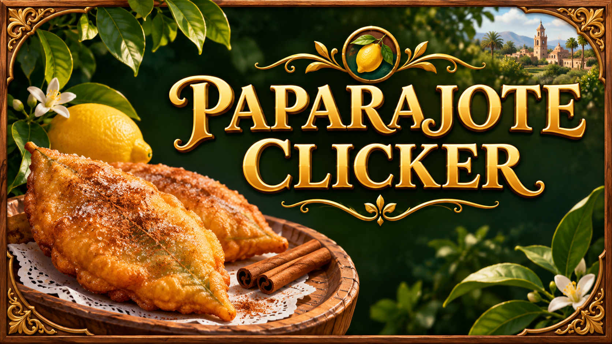
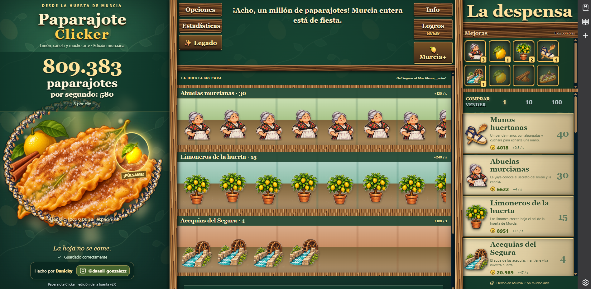
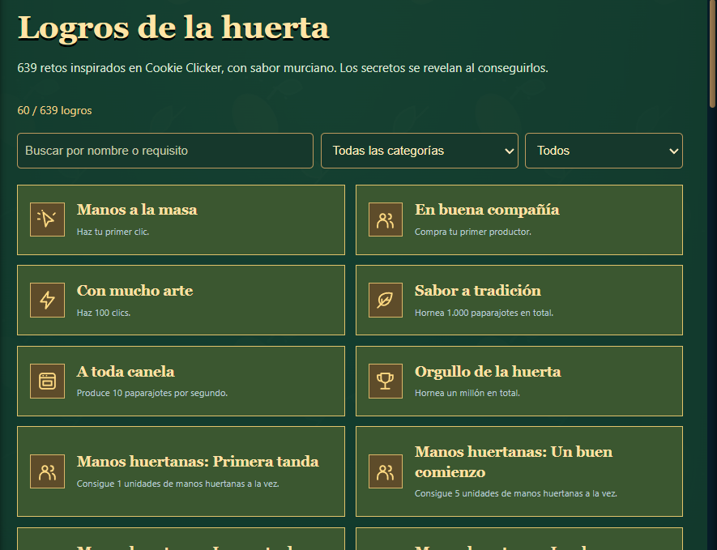
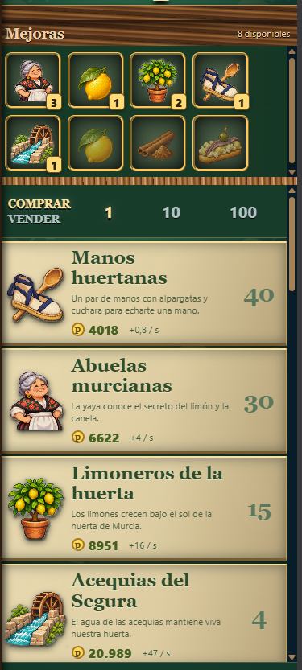

# 🍋 PAPARAJOTE CLICKER 🍋

### 🌿 ¡La huerta de Murcia está en tus manos!

Un juego incremental inspirado en Cookie Clicker,
con mucho limón, canela y esencia murciana.

### 🎮 [¡JUGAR GRATIS AHORA!](https://paparajote.online)

🌐 https://paparajote.online

---

## 🌿 ¿Qué es Paparajote Clicker?

¡Empieza con un solo paparajote y construye
el mayor imperio de la huerta murciana!

Haz clic, consigue productores, compra mejoras
y desbloquea nuevas mecánicas.

¿Hasta dónde puedes llegar?

## ✨ Características

- 🍋 Produce cantidades increíbles de paparajotes.
- 👵 Contrata abuelas murcianas.
- 🌳 Cultiva limoneros y desarrolla tu huerta.
- 🏆 Consigue hasta 639 logros.
- ⚡ Descubre cientos de mejoras.
- 🎮 Desbloquea sistemas y minijuegos.
- 💾 Guarda tu progreso online.
- 🎨 Disfruta de una estética inspirada en Murcia.

## 📸 Capturas del juego

### 🍋 ¡Construye tu imperio murciano!

### 🏆 Logros y mejoras

<table>
<tr>
<td align="center" width="65%">

<b>🏆 639 logros por desbloquear</b>

</td>
<td align="center" width="35%">

<b>🛒 La despensa murciana</b>

</td>
</tr>
</table>

## 🖥️ Plataformas

| Plataforma | Estado |
|------------|--------|
| 🌐 Navegador | ✅ Disponible |
| 🖥️ Windows | 🔧 En preparación |
| 🎮 Steam | 📋 Planeado |

## 🚀 ¡Empieza a jugar!

### 👉 [paparajote.online](https://paparajote.online)

Gratis y directamente desde tu navegador.

## 👨‍💻 Desarrollador

**Danicky**

Proyecto independiente inspirado en la cultura
y las tradiciones de Murcia.

© 2026 Paparajote Clicker.

El código fuente del juego es privado.
